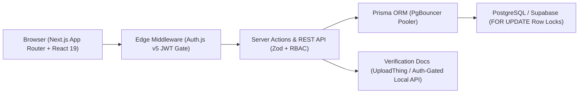

# Fazaa (فزعة)

A full-stack community volunteering platform built with **Next.js 15**, **TypeScript**, **Prisma**, and **PostgreSQL (Supabase)**. Volunteers discover local events and claim open slots in one click or submit an application for organizer review; organizers structure events into capacity-limited tasks, track live sign-ups, verify their organization, and export volunteer rosters to CSV or styled Excel.

---

## Architecture



- **Auth boundary:** `src/middleware.ts` imports the Edge-safe `src/server/auth.config.ts` to protect routes at the edge without loading Prisma or `bcryptjs`. Every Server Action and API route independently re-verifies the user session, role (`VOLUNTEER`, `ORGANIZER`, `ADMIN`), and resource ownership.
- **Overbooking-proof capacity:** Task capacity is never stored as a mutable counter column. Filled slots are computed from `COUNT(TaskAssignment WHERE status = 'CONFIRMED')`. Both instant claims (`claimTask`) and organizer approvals (`approveAssignment`) run inside `db.$transaction` with `SELECT id FROM "Task" WHERE id = $1 FOR UPDATE`, serializing concurrent requests on the same task row.

---

## Key Features

- **Role-Based Access Control (3 Roles):** Credentials authentication via Auth.js v5 (`bcryptjs` password hashing, JWT sessions) supporting `VOLUNTEER`, `ORGANIZER`, and `ADMIN` workflows.
- **Event & Task Lifecycle:** Draft-to-published workflow gated on organizer verification, with Jordan governorate/district filtering (`City` and `District` models) and Arabic UI support.
- **Dual Sign-Up Modes:**
  - `INSTANT_CLAIM` — volunteers click **"I'm ready"** for immediate confirmation with row-locked capacity enforcement.
  - `APPROVAL` — volunteers apply with an optional note; organizers approve or reject from their dashboard, with capacity re-checked at approval time.
- **Live Slot Updates & Notifications:** 2-second task snapshot polling (`/api/realtime/tasks/[taskId]`) with optimistic UI and conflict handling, plus authenticated in-app notifications (`/api/notifications`).
- **Organizer Verification:** Organizers upload NGO licenses or official IDs (JPEG/PNG/PDF up to 10 MB) to UploadThing in production or an auth-checked, path-traversal-safe local download endpoint (`/api/files/[key]`) in development. Admins approve or reject submissions to award the verified badge.
- **Roster Exports:** Organizers download UTF-8 BOM CSV (`papaparse`) and styled Excel (`xlsx-js-style`) volunteer rosters directly from each event tracker.
- **Dark Mode & Security Headers:** No-flash class-based dark mode with system fallback, plus `X-Frame-Options: DENY`, `X-Content-Type-Options: nosniff`, `Referrer-Policy`, and `Permissions-Policy` configured in `next.config.ts`.

---

## Tech Stack

| Layer | Technologies |
| :--- | :--- |
| **Frontend** | Next.js 15 (App Router, Turbopack), React 19, TypeScript, Tailwind CSS v4, shadcn/ui (Radix UI), Lucide, Sonner |
| **Backend** | Next.js Server Actions, Next.js Route Handlers (`/api/*`), Zod v4 |
| **Auth & Security** | Auth.js v5 (`next-auth@beta`), `bcryptjs`, Edge Middleware + Server-Side RBAC |
| **Database** | PostgreSQL (Supabase), Prisma 5 (`DATABASE_URL` transaction pooler + `DIRECT_DATABASE_URL` migrations), UUIDv7 PKs |
| **Exports & Uploads** | `papaparse`, `xlsx-js-style`, UploadThing |

---

## Project Structure

```text
prisma/
├─ schema.prisma              # 9 relational models (User, Event, Task, TaskAssignment, City, District, ...)
├─ migrations/                # SQL migration history
├─ seed.ts                    # Demo users, events, tasks, and sign-ups
└─ seed-locations.ts          # Jordan 12 governorates and districts

src/
├─ app/
│  ├─ (marketing)/            # Public landing page and featured events
│  ├─ (auth)/                 # Login, register, forgot-password
│  ├─ (app)/                  # Authenticated shell: events, dashboard, verify, profile
│  └─ api/                    # Auth.js, register, notifications, realtime task snapshots, file downloads
├─ features/                  # Domain-colocated actions, Zod schemas, queries, and components
│  └─ auth/ dashboard/ events/ export/ locations/ realtime/ tasks/ theme/ verification/
├─ components/                # Shared UI primitives (shadcn/ui), notifications dropdown, theme toggle
├─ server/                    # db.ts (Prisma singleton), auth.ts, auth.config.ts, errors.ts
├─ lib/                       # Formatting and utility helpers
└─ middleware.ts              # Edge route protection
```

---

## Getting Started

### Prerequisites
- Node.js 20+
- PostgreSQL database (Supabase or local Postgres)

### 1. Install dependencies
```bash
npm install
```

### 2. Configure environment variables
Copy `.env.example` to `.env` and fill in your values:
```bash
cp .env.example .env
```

| Variable | Required | Description |
| :--- | :---: | :--- |
| `DATABASE_URL` | Yes | Runtime Postgres connection (use Supabase transaction pooler with `?pgbouncer=true&connection_limit=5`) |
| `DIRECT_DATABASE_URL` | Yes | Direct or session-pooler Postgres connection used by Prisma CLI migrations |
| `AUTH_SECRET` | Yes | Auth.js v5 JWT secret (generate with `openssl rand -base64 32`) |
| `UPLOADTHING_TOKEN` | No | UploadThing token for production document uploads (defaults to local `.uploads/` in dev) |

### 3. Run migrations and seed demo data
```bash
npx prisma migrate dev
npx prisma db seed
```

### 4. Start the development server
```bash
npm run dev
```
Open [http://localhost:3000](http://localhost:3000).

### Demo Accounts (After Seeding)

| Email | Password | Role |
| :--- | :--- | :--- |
| `admin@fazaa.sa` | `password123` | `ADMIN` |
| `organizer@fazaa.sa` | `password123` | `ORGANIZER` |
| `volunteer@fazaa.sa` | `password123` | `VOLUNTEER` |
| `sara@fazaa.sa` | `password123` | `VOLUNTEER` |

---

## Scripts

- `npm run dev` — Start Next.js dev server with Turbopack
- `npm run build` — Generate Prisma Client and build production bundle
- `npm start` — Run the production server
- `npm run lint` — Run ESLint
- `npx prisma studio` — Inspect database tables in the browser

---

## Production Notes

- **Serverless pooling:** On Vercel or other serverless hosts, keep `DATABASE_URL` on the transaction pooler with `?pgbouncer=true&connection_limit=1` and route migrations through `DIRECT_DATABASE_URL`.
- **Secrets:** Generate a unique `AUTH_SECRET` per environment (`openssl rand -base64 32`).
- **Document storage:** When `UPLOADTHING_TOKEN` is enabled in production, configure private/signed access for verification documents. Local development serves files through `/api/files/[key]` with strict owner-or-admin checks.
- **Database surface:** Migrations enable Row-Level Security (RLS) on tables without public Data API policies, keeping database access scoped to the server-side Prisma client.

---

## License

MIT License — see [LICENSE](LICENSE).
